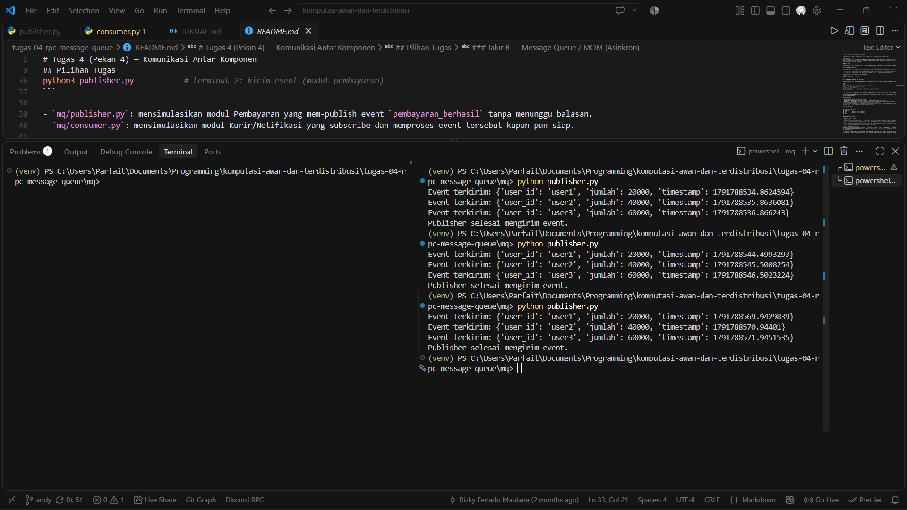

# Jurnal Proses — Tugas 4

## Jalur yang dipilih
- [RPC / MQ / keduanya], alasan: ...

### Jalur MQ
 - Alasan: Notifikasi ke modul kurir hanya perlu memberi tahu bahwa suatu event telah terjadi, sehingga tidak membutuhkan balasan langsung. Dengan MQ, modul pembayaran cukup mem-publish event ke antrean lalu melanjutkan prosesnya tanpa menunggu. Jika modul kurir sedang down atau di-deploy ulang, pesan tetap tersimpan di antrean dan diproses setelah modul kurir aktif kembali, sehingga modul pembayaran tidak ikut terganggu.

## Kendala teknis
- Error saat setup (mis. koneksi RabbitMQ ditolak, port bentrok): ...

   - Perintah `python3 -m venv venv && source venv/bin/activate` tidak dapat dikenali
        - Solusi: Menjalankan perintah nya secara terpisah dan mengganti `python3` ke `python`.

    - Muncul perintah `ModuleNotFoundError: No Module named 'pika'` karena belum mengaktifkan venv
        - Solusi: mengganti command `source venv/bin/activate` ke `venv\Scripts\Activate.ps1`

## Uji "pesan tidak hilang" (khusus Jalur B)
- Langkah uji: matikan consumer → jalankan publisher → nyalakan consumer
- Hasil yang diamati: ...

*Publisher mengirim event saat consumer mati.*

*Consumers = 0, Ready = 9: pesan tersimpan di antrean.*

*Consumers = 1, Ready = 0: seluruh pesan sudah diproses.*

## Log Penggunaan AI (Level 2)

> Wajib diisi sesuai kebijakan Level 2 di [`../RUBRIK-UMUM.md`](../RUBRIK-UMUM.md). Tulis "Tidak memakai AI" pada baris pertama jika memang tidak dipakai. Hanya untuk brainstorming ide/outline — bukan untuk kode/analisis/teks akhir.

| Tanggal | Tool AI | Prompt yang diberikan | Ringkasan saran/ide AI | Bagaimana diolah jadi tulisan/kode sendiri |
|---|---|---|---|---|
| ... | ... | ... | ... | ... |
