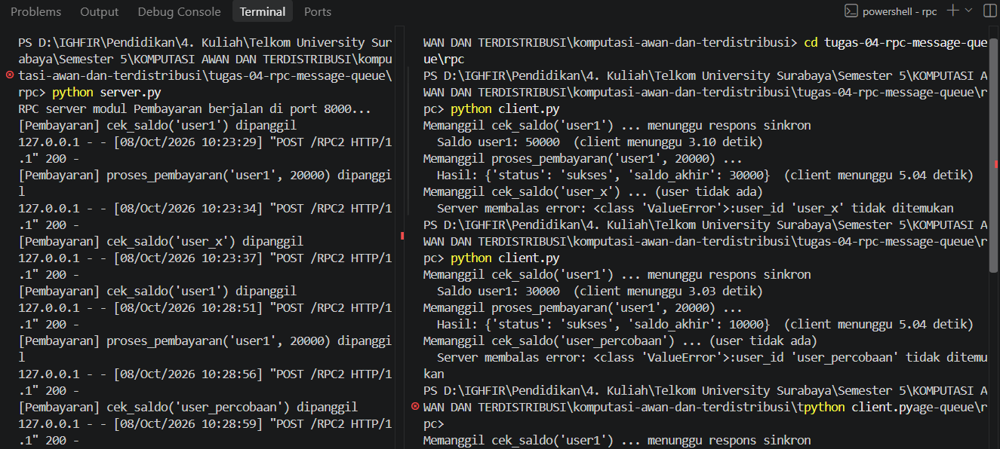
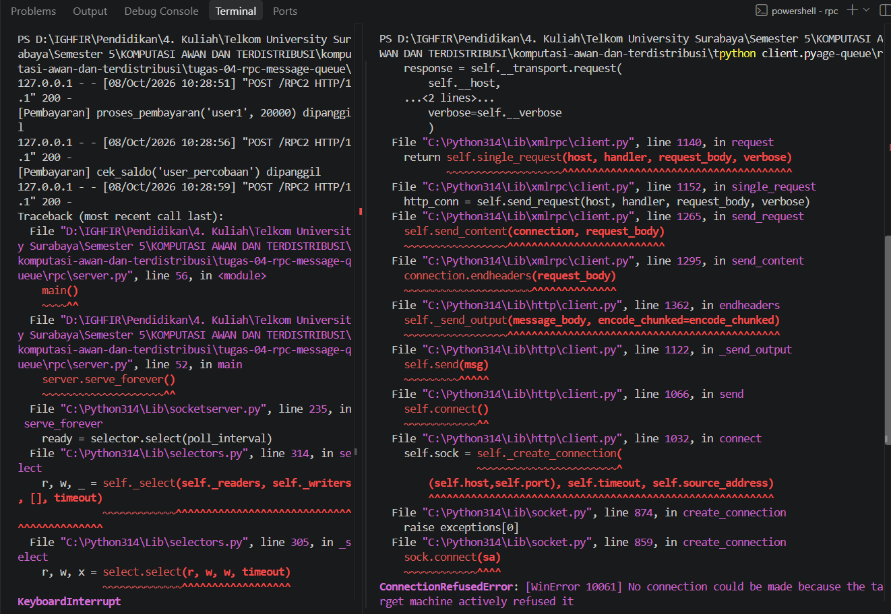

# Jurnal Proses — Tugas 4

## Jalur yang dipilih
Sebelum menentukan jalur apa yang kami pilih, kami akan menjelaskan kedua jalur yang pertimbangkan. 

### Jalur RPC

Berdasarkan gambar tersebut, Client menunggu ± 0,10 detik pada proses_pembayaran sebelum baris berikutnya dieksekusi (di gambar terlihat 3,10 detik karena kami sengaja menge-set 3 detik sebagai *delay* seperti pemanggilan server yang berada jauh dari client yang membuat client harus menunggu jawaban dari server). Client memanggil fungsi di server terlihat seperti memanggil fungsi lokal dan sintaksnya pun sederhana. Serta client langsung mendapatkan *return value* secara instan seperti di gambar. Tapi konsekuensinya, kedua pihak harus aktif/hidup pada waktu yang bersamaan dan client bergantung pada kecepatan serta ketersediaan server. Karena jika server mati, akan terjadi *error* seperti di gambar berikut.

### Jalur MQ
 - Alasan: Notifikasi ke modul kurir hanya perlu memberi tahu bahwa suatu event telah terjadi, sehingga tidak membutuhkan balasan langsung. Dengan MQ, modul pembayaran cukup mem-publish event ke antrean lalu melanjutkan prosesnya tanpa menunggu. Jika modul kurir sedang down atau di-deploy ulang, pesan tetap tersimpan di antrean dan diproses setelah modul kurir aktif kembali, sehingga modul pembayaran tidak ikut terganggu.

### Pilihan kami
- Keduanya (kombinasi RPC dan MQ)
- Alasan: Karena cek saldo dan proses pembayaran membutuhkan hasil langsung untuk melanjutkan alur, yang bisa didapatkan dengan metode RPC dan tidak bisa didapatkan pada metode MQ. Sedangkan notifikasi ke kurir hanya perlu memberitahuan ke pihak lain tanpa membutuhkan balasan yang bisa didapatkan dengan metode MQ dan tidak bisa didapatkan pada metode RPC.
- Jika RPC dipakai untuk notifikasi kurir dan kondisi kurir sibuk/lambat, pembayaran ikut menunggu sampai kurir membalas sehingga waktu respon pembayaran pun menjadi lama sesuai lambatnya kurir, padahal tugas pembayaran sudah selesai. Atau ketika menggunakan server RPC satu threads atau bahkan "service" kurir mati. Hal tersebut dapat menyebabkan satu permintaan diproses pada satu waktu atau koneksi koneksi tersambung tapi tidak dibalas tanpa ada batasan secara default untuk RPC. Dengan kata lain, jika RPC digunakan untuk notifikasi kurir, akan terjadi efek domino jika terjadi masalah di kurir yang berefek muncul masalah di pembayaran dan pesanan. Belum lagi terjadi data yang tidak konsisten yaitu ketika saldo pengguna sudah terpotong, tetapi notifikasi ke kurir gagal dan pesanan tidak pernah diantar.
- Sedangkan jika MQ dipakai untuk cek_saldo, permintaan masuk antrean dan jawaban harus dikirim lewat antrean balasan. Padahal cek_saldo membutuhkan jawaban saat itu juga. Belum lagi karena kompleksitasnya, membuat cek_saldo harus memiliki latensi yang lebih besar tanpa ada manfaatnya. 

## Kendala teknis
- Error saat setup (mis. koneksi RabbitMQ ditolak, port bentrok): ...

   - Perintah `python3 -m venv venv && source venv/bin/activate` tidak dapat dikenali
        - Solusi: Menjalankan perintah nya secara terpisah dan mengganti `python3` ke `python`.

    - Muncul perintah `ModuleNotFoundError: No Module named 'pika'` karena belum mengaktifkan venv
        - Solusi: mengganti command `source venv/bin/activate` ke `venv\Scripts\Activate.ps1`

## Uji "pesan tidak hilang" (khusus Jalur B)
- Langkah uji: matikan consumer → jalankan publisher → nyalakan consumer
- Hasil yang diamati: ...

*Publisher mengirim event saat consumer mati.*

*Consumers = 0, Ready = 9: pesan tersimpan di antrean.*

*Consumers = 1, Ready = 0: seluruh pesan sudah diproses.*

## Log Penggunaan AI (Level 2)

> Wajib diisi sesuai kebijakan Level 2 di [`../RUBRIK-UMUM.md`](../RUBRIK-UMUM.md). Tulis "Tidak memakai AI" pada baris pertama jika memang tidak dipakai. Hanya untuk brainstorming ide/outline — bukan untuk kode/analisis/teks akhir.

| Tanggal | Tool AI | Prompt yang diberikan | Ringkasan saran/ide AI | Bagaimana diolah jadi tulisan/kode sendiri |
| 13/10/2026 | claude | Kamu adalah asisten yang membantu mahasiswa menyusun laporan "Penggunaan AI" untuk Tugas 4 (komunikasi antar-modul: RPC vs Message Queue). Tulis dalam Bahasa Indonesia yang formal tapi natural, dari sudut pandang orang pertama (saya) KONTEKS TUGAS Skenario: modul pembayaran perlu cek saldo dan memproses pembayaran, lalu memberi notifikasi ke modul kurir. Jalur yang saya pilih: kombinasi RPC dan MQ. RPC untuk cek_saldo dan proses pembayaran, karena alur butuh hasil langsung. MQ (RabbitMQ, library pika) untuk notifikasi ke kurir, karena hanya perlu memberi tahu tanpa menunggu balasan. Alasan menolak sebaliknya: RPC untuk notifikasi kurir menyebabkan pembayaran ikut lambat/macet bila kurir lambat atau mati, serta berisiko data tidak konsisten (saldo terpotong tapi kurir tidak terhubung). MQ untuk cek_saldo menambah latensi dan kompleksitas (antrean balasan) tanpa manfaat. Kendala teknis yang saya alami: 1. Perintah `python3 -m venv venv && source venv/bin/activate` tidak dikenali di Windows. Solusi: dijalankan terpisah, `python3` diganti `python`. 2. `ModuleNotFoundError: No module named 'pika'` karena venv belum aktif. Solusi: memakai `venv\Scripts\Activate.ps1`. Uji "pesan tidak hilang": consumer dimatikan, publisher dijalankan, lalu consumer dinyalakan. Hasil: saat consumer mati, Consumers = 0 dan Ready = 9 (pesan tertahan di antrean); setelah consumer menyala, Consumers = 1 dan Ready = 0 (semua pesan terproses). | RPC dipakai untuk cek saldo dan proses pembayaran, karena alur berikutnya butuh hasil langsung sebelum bisa dilanjutkan. MQ dipakai untuk notifikasi ke kurir, karena cukup memberi tahu bahwa ada event tanpa perlu menunggu balasan. RPC untuk notifikasi kurir berisiko membuat pembayaran ikut lambat atau macet jika kurir sibuk, mati, atau server hanya satu thread. Masalah di kurir bisa merambat ke pembayaran dan pesanan (efek domino), dan data bisa tidak konsisten, misalnya saldo sudah terpotong tetapi kurir tidak pernah diberi tahu. MQ untuk cek saldo menambah kompleksitas (butuh antrean balasan) dan latensi, padahal jawaban dibutuhkan saat itu juga. | Jika RPC dipakai untuk notifikasi kurir, pembayaran ikut menunggu balasan kurir. Bila kurir sibuk, lambat, mati, atau servernya hanya satu thread, waktu respon pembayaran ikut memburuk dan koneksi bisa menggantung tanpa batas waktu secara default. Masalah di kurir pun merambat ke pembayaran dan pesanan (efek domino). Data juga bisa tidak konsisten, misalnya saldo sudah terpotong tetapi notifikasi ke kurir gagal sehingga pesanan tidak pernah diantar. Jika MQ dipakai untuk cek saldo, permintaan harus masuk antrean dan jawabannya dikirim lewat antrean balasan. Ini menambah kompleksitas dan latensi tanpa manfaat, karena cek saldo membutuhkan jawaban saat itu juga. |
| 07/10/2026 | Gemini | Sebagai ahli di bidang komunikasi antar modul terutama pada RPC dan Message Queue, jelaskan kelebihan dan kekurangan secara lengkap dan detail berupa tabel dan penjelasan yang mudah dipahami | Client memanggil fungsi di server terlihat seperti memanggil fungsi lokal dan sintaksnya pun sederhana. Serta client langsung mendapatkan *return value* secara instan seperti di gambar. Tapi konsekuensinya, kedua pihak harus aktif/hidup pada waktu yang bersamaan dan client bergantung pada kecepatan serta ketersediaan server. Karena jika server mati, akan terjadi *error*. |
| ... | ... | ... | ... | ... |
