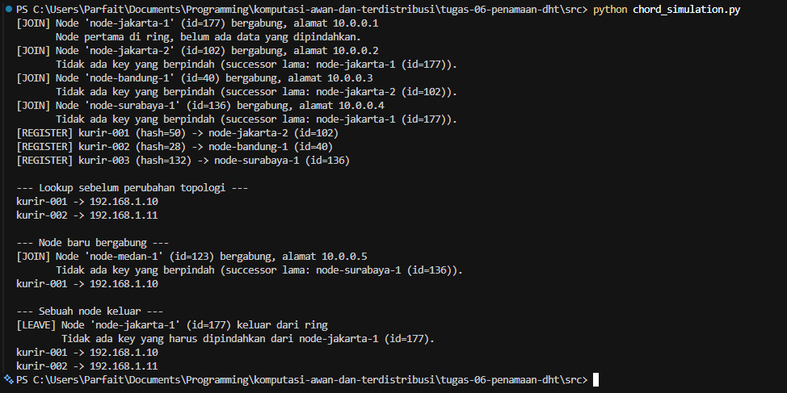

# Jurnal Proses — Tugas 6

## Implementasi find_successor
- **Kesalahan pertama:** Pada implementasi awal, fungsi
  `find_successor` hanya menggunakan `min(candidates)` tanpa menangani kondisi
  ketika tidak terdapat node dengan nilai hash lebih besar atau sama dengan
  hash key. Kondisi tersebut terjadi apabila hash key melebihi hash seluruh
  node di dalam ring, sehingga daftar `candidates` kosong dan memunculkan
  galat `ValueError: min() arg is an empty sequence`.
- **Cara memperbaikinya:** Perbaikan dilakukan dengan menerapkan mekanisme
  *wrap-around* sesuai sifat melingkar pada ring Chord. Apabila tidak ada node
  dengan hash >= key, fungsi mengembalikan node dengan hash terkecil
  (`min(self.nodes)`). Selain itu, ditambahkan pengecekan kondisi ring kosong
  yang mengembalikan `None` agar fungsi tidak menghasilkan galat ketika belum
  terdapat node.

## Skenario join/leave

- Hasil sebelum & sesudah node baru bergabung:
  - Urutan node berdasarkan nilai id: node-bandung-1 (40), node-jakarta-2 (102), node-surabaya-1 (136), dan node-jakarta-1 (177), kemudian kembali ke node-bandung-1 (*wrap-around*).
  - Pemetaan kurir terhadap node penanggung jawab:

    | Kurir | Hash | Node penanggung jawab |
    |---|---|---|
    | kurir-002 | 28 | node-bandung-1 (id=40) |
    | kurir-001 | 50 | node-jakarta-2 (id=102) |
    | kurir-003 | 132 | node-surabaya-1 (id=136) |

  - Sebelum bergabung: lookup kurir-001 menghasilkan 192.168.1.10 dan kurir-002 menghasilkan 192.168.1.11.
  - Proses: node-medan-1 (id=123) bergabung dengan successor lama node-surabaya-1 (id=136). Program mencatat bahwa tidak ada key yang berpindah.
  - Analisis: node-medan-1 hanya bertanggung jawab atas key dengan hash pada rentang 103-123. Tidak terdapat kurir pada rentang tersebut, sedangkan kurir-003 (hash=132) tetap menjadi tanggung jawab node-surabaya-1.
  - Sesudah bergabung: lookup kurir-001

- Hasil sebelum & sesudah node keluar:
  - Sebelum keluar: node-jakarta-1 (id=177) merupakan node dengan id terbesar dalam ring. Node ini bertanggung jawab atas key dengan hash pada rentang 137-177.
  - Proses: node-jakarta-1 (id=177) dikeluarkan dari ring. Program mencatat bahwa tidak ada key yang harus dipindahkan.
  - Analisis: tidak terdapat kurir dengan hash pada rentang 137-177 (hash kurir-001 adalah 50, kurir-002 adalah 28, dan kurir-003 adalah 132), sehingga node tersebut tidak memegang data apa pun dan tidak ada key yang perlu dipindahkan ke successor.
  - Sesudah keluar: lookup kurir-001 menghasilkan 192.168.1.10 dan lookup kurir-002 menghasilkan 192.168.1.11, sehingga dapat disimpulkan tidak ada data yang hilang.

## Log Penggunaan AI (Level 2)

> Wajib diisi sesuai kebijakan Level 2 di [`../RUBRIK-UMUM.md`](../RUBRIK-UMUM.md). Tulis "Tidak memakai AI" pada baris pertama jika memang tidak dipakai. Hanya untuk brainstorming ide/outline — bukan untuk kode/analisis/teks akhir.

| Tanggal | Tool AI | Prompt yang diberikan | Ringkasan saran/ide AI | Bagaimana diolah jadi tulisan/kode sendiri |
|---|---|---|---|---|
| ... | ... | ... | ... | ... |
