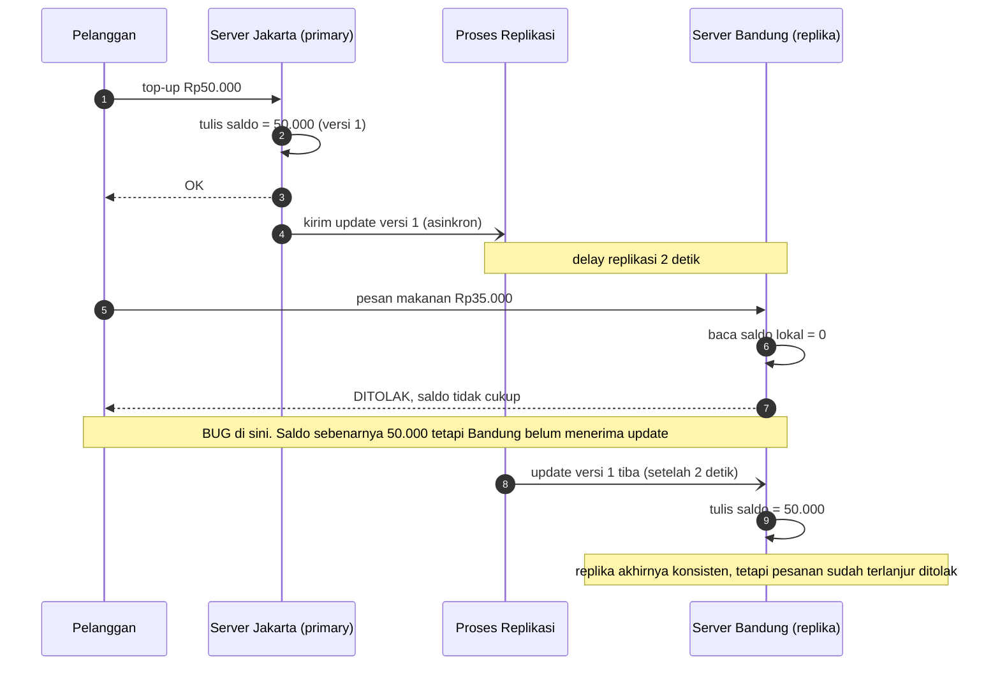
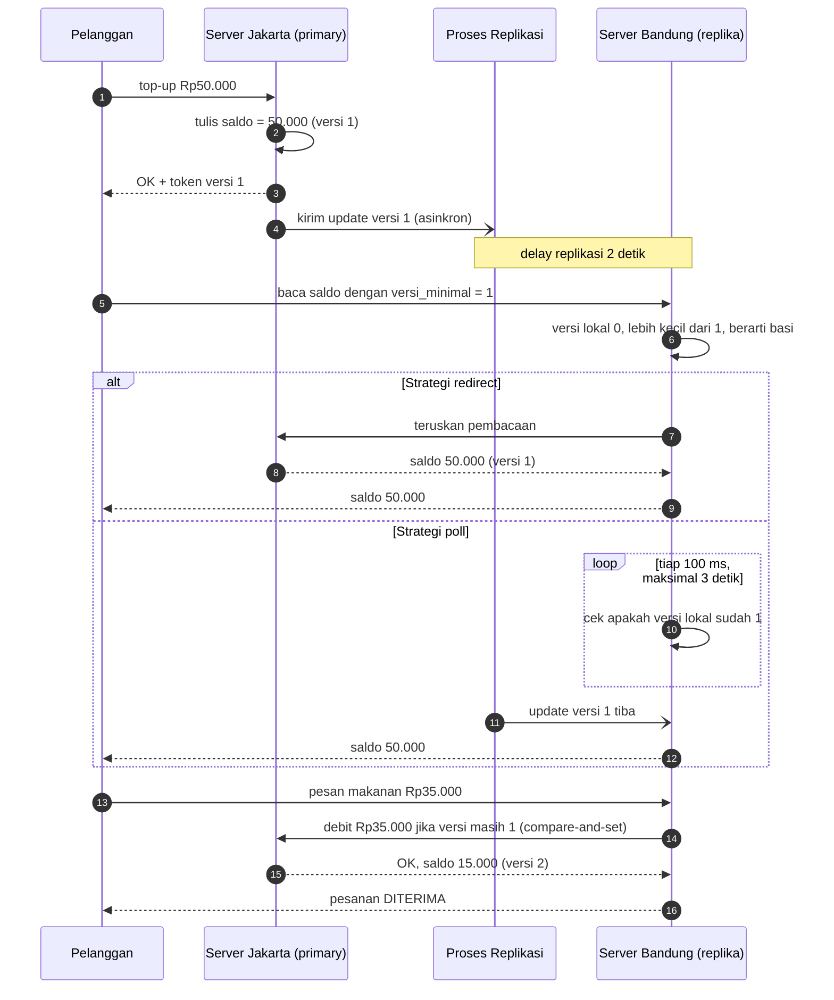

# Jurnal Proses — Tugas 7

## Diskusi pemilihan model konsistensi
- **Argumen yang dipertimbangkan:**
  - Saldo *e-wallet* adalah data finansial. Pembacaan *stale* bisa menolak transaksi yang sebenarnya sah, atau meloloskan transaksi melebihi saldo jika validasi dilakukan di replika yang tertinggal.
  - *Eventual consistency* masih berguna untuk data tidak kritis, misalnya jumlah *like*, rekomendasi restoran, atau jumlah tayangan. Keterlambatan sementara di sana tidak menimbulkan kerugian langsung.
  - Urutan operasi saldo (`top-up`, pembayaran, *refund*, penarikan) harus sama di semua replika. Jika urutannya berbeda, saldo akhir bisa berbeda.
  - Replikasi asinkron dari primary ke replika yang dibaca client hanya memberi *eventual consistency*. Client yang baru menulis bisa membaca replika yang belum menerima tulisannya.
  - Karena itu dipakai *client-centric consistency*, yaitu **Read-Your-Writes (RYW)**. RYW lebih lemah dari sequential consistency, tetapi cukup untuk kasus ini dan lebih murah diterapkan.
  - RYW hanya memperbaiki sisi baca. Penulisan saldo tetap harus diserialisasi di primary agar dua request pada wallet yang sama (misalnya dua perangkat) tidak saling menimpa.

  agar mempermudah dalam memahaminya, kami sajikan dalam bentuk tabel berikut.

| Data / operasi | Dampak jika basi | Model yang tepat | Alasan |
|---|---|---|---|
| **Debit/kredit saldo** (top-up, bayar pesanan) | Kerugian uang, sengketa, masalah audit | **Urutan tulis tunggal per akun** (sequential per akun) | Dua penulisan atas saldo yang sama tidak boleh saling timpa atau dibaca dari data basi. Semua penulisan satu akun lewat satu primary, sehingga ada satu urutan operasi yang sama untuk akun itu. |
| **Validasi saldo saat membayar** | Salah setuju atau salah tolak | Baca dari **primary** (data otoritatif) | Keputusan bisnis atas uang tidak boleh diambil dari replika yang mungkin tertinggal. |
| **Pelanggan melihat saldonya sendiri** | Pelanggan bingung, mengira top-up gagal | **Read-Your-Writes**  | Yang dilihat pelanggan harus mencerminkan tindakannya sendiri. Tidak perlu semua replika sinkron seketika. |
| Menu, rating restoran, jumlah *like*/ulasan | Tampilan sedikit terlambat, tidak ada kerugian uang | **Eventual** | Basi beberapa detik tidak berbahaya, dan menuntut konsistensi kuat hanya menambah latensi. |

Intinya, salah menampilkan "jumlah like" 1.203 padahal 1.205 tidak merugikan siapa pun, sedangkan salah menampilkan saldo bisa menggagalkan transaksi atau meloloskan transaksi yang seharusnya ditolak.

- **Kesimpulan akhir & alasan:**
  - **Eventual consistency saja tidak cukup** untuk saldo. Dampak bisnisnya besar: transaksi sah ditolak, saldo tidak cocok, kepercayaan pengguna turun.
  - Model yang dipilih: **penulisan saldo diserialisasi di primary (Jakarta)**, ditambah **Read-Your-Writes** untuk pembacaan dari replika.
  - RYW diimplementasikan dengan **versi penulisan**. Setiap penulisan menghasilkan nomor versi baru (penomoran global yang monoton), dan replika menyimpan versi terakhir **per pengguna**. Client menyimpan versi dari penulisan terakhirnya sendiri. Saat membaca dari replika, replika hanya melayani jika versinya >= versi client. Jika belum, ada dua pilihan: menunggu replikasi (*poll*) atau *redirect* ke Jakarta. Jika *poll* melewati batas waktu, sistem *fallback* ke Jakarta.

  agar mempermudah dalam memahaminya, kami sajikan dalam bentuk tabel berikut.

| Strategi | Cara kerja | Kelebihan | Kekurangan |
|---|---|---|---|
| **Redirect ke primary** | Replika meneruskan pembacaan ke Jakarta | Respons langsung benar, tanpa menunggu | Menambah beban dan latensi lintas region, hanya selama replika tertinggal |
| **Poll/tunggu** | Replika menunggu update tiba (cek tiap 100 ms, maksimal 3 detik), jika lewat batas fallback ke redirect | Pembacaan tetap lokal | Latensi sebesar sisa delay replikasi (di simulasi 2,00 detik) |

## Sequence diagram
### Tanpa jaminan konsistensi 
 

 
Kegagalan terjadi pada langkah 5–7, yaitu Bandung membaca data lokal yang belum menerima versi 1 lalu menolak pesanan.
 
### Dengan Read-Your-Writes 
 

 
Perbaikan pada langkah 7–8 (Bandung mendeteksi dirinya basi lewat versi) dan langkah di blok `alt` (jalur yang menghasilkan saldo benar). Langkah debit di akhir menunjukkan aturan bahwa penulisan dan validasi uang tetap di primary.

## Simulasi
- Dijalankan dengan `python src/replica_simulation.py`. Semua `assert` lolos. Output lengkap ada di `bukti/output.txt`.
- **Perbaikan di `main()`:** versi awal mengasumsikan saldo 50000 padahal tidak ada top-up awal (0 + 20000 ≠ 70000), sehingga `AssertionError`. Kami menambahkan skenario naif di awal, yang sekaligus menunjukkan bug *inconsistent read*.

- **Hasil:**

| Skenario | Hasil | Keterangan |
|---|---|---|
| Naif | 0.0 | Top-up 50000 ke Jakarta (versi 1), Bandung dibaca langsung (t=0.00s), sebelum replikasi 2 detik selesai. Bug terlihat. |
| RYW (poll) | 70000.0 | Bandung versi 1 < 2, menunggu ±2 detik sampai versi 2 tiba, lalu membaca 70000. |
| RYW (redirect) | 80000.0 | Bandung versi 2 < 3, langsung dialihkan ke Jakarta tanpa menunggu. |
| RYW (poll timeout) | 85000.0 | `max_wait` 0.5s lebih pendek dari delay replikasi, sehingga *fallback* ke Jakarta. |
| Akhir | 85000 = 85000 | Jakarta dan Bandung konvergen (*eventual consistency* tercapai). |

- **Mekanisme di kode:** `top_up()` mengembalikan nomor versi sebagai token. `baca_saldo_read_your_writes()` membaca saldo dan versi secara atomik lewat `snapshot()`. `replicate()` mengabaikan update bernomor versi lebih lama (terlihat di log "versi 3 diabaikan"), sehingga replikasi yang terlambat tidak menimpa data baru.
- **Trade-off:** mode *poll* menambah latensi baca (±2 detik pada skenario ini). Mode *redirect* dan *fallback* menambah beban ke Jakarta dan membuatnya jadi titik ketergantungan.
- **Batasan simulasi:** hanya satu pengguna, tanpa operasi debit/pembayaran, tanpa kegagalan Jakarta atau replikasi yang hilang. Serialisasi penulisan hanya dibuktikan lewat `_lock`, belum lewat uji konkuren.

## Log Penggunaan AI (Level 2)

> Wajib diisi sesuai kebijakan Level 2 di [`../RUBRIK-UMUM.md`](../RUBRIK-UMUM.md). Tulis "Tidak memakai AI" pada baris pertama jika memang tidak dipakai. Hanya untuk brainstorming ide/outline — bukan untuk kode/analisis/teks akhir.

| Tanggal | Tool AI | Prompt yang diberikan | Ringkasan saran/ide AI | Bagaimana diolah jadi tulisan/kode sendiri |
|---|---|---|---|---|
|17/11/2026| GEMINI |"Sebuah aplikasi e-wallet memiliki server primary di Jakarta dan beberapa server replika di daerah lain untuk melayani pembacaan data. Sistem saat ini menggunakan replikasi asinkron yang hanya menjamin eventual consistency. Analisis apakah eventual consistency sudah cukup untuk mengelola saldo pengguna! Jika tidak, model konsistensi apa yang paling tepat diterapkan beserta alasan dan mekanisme implementasinya?"| 1. Evaluasi Model Lama: Eventual consistency tidak memadai untuk data saldo finansial karena pembacaan data usang (stale read) berisiko meloloskan transaksi melebihi saldo atau menolak transaksi yang sah. Model ini hanya cocok untuk data non-kritis (seperti jumlah like atau rekomendasi).2. Solusi Arsitektur: Gunakan kombinasi serialisasi penulisan pada server primary (Jakarta) untuk menjaga urutan transaksi (top-up, bayar, refund), dipadukan dengan client-centric consistency berupa Read-Your-Writes (RYW) pada sisi pembacaan.3. Mekanisme Implementasi: Terapkan penomoran versi (versioning) global yang meningkat secara monoton pada setiap transaksi berhasil. Client menyimpan versi terakhirnya, dan server replika hanya boleh melayani pembacaan jika versi datanya minimal sama dengan versi client ($\text{versi}_{\text{replika}} \ge \text{versi}_{\text{client}}$). Jika replika tertinggal, sistem melakukan polling singkat dengan fallback (pengalihan) ke server Jakarta apabila melewati batas waktu.|Penggunaan eventual consistency pada layanan e-wallet tidak disarankan untuk pengelolaan saldo karena menyangkut data finansial yang sensitif. Jika pengguna membaca data dari server replika yang belum diperbarui (stale), sistem berpotensi menolak transaksi yang sebenarnya memiliki saldo cukup, atau justru meloloskan transaksi melebihi batas saldo. Dampaknya tidak hanya merugikan secara finansial, tetapi juga menurunkan kepercayaan pengguna. Model eventual consistency sebaiknya dibatasi hanya untuk fitur non-kritis seperti jumlah tayangan atau rekomendasi. Sebagai solusinya, sistem perlu menerapkan pemisahan strategi antara proses tulis dan baca. Seluruh operasi perubahan saldo—mulai dari top-up, pembayaran, refund, hingga penarikan—wajib diserialisasi terpusat di server primary Jakarta agar urutan eksekusinya seragam dan mencegah konflik pembaruan dari dua perangkat berbeda secara bersamaan. Sementara itu, untuk menjaga performa baca di berbagai daerah tanpa mengorbankan akurasi, diterapkan model client-centric consistency jenis Read-Your-Writes (RYW)Secara teknis, mekanisme RYW ini dijalankan menggunakan pelacakan nomor versi. Setiap transaksi yang berhasil diproses di Jakarta akan menghasilkan nomor versi baru yang terus naik secara berurutan, lalu dicatat oleh aplikasi client maupun replika. Ketika pengguna mengecek saldo melalui server replika terdekat, replika akan membandingkan versi datanya dengan versi milik client. Jika versi replika sudah sejajar atau lebih baru, saldo langsung ditampilkan. Namun, jika replika masih tertinggal, sistem akan menunggu proses sinkronisasi dalam batas waktu singkat, dan otomatis mengalihkan permintaan langsung ke server Jakarta jika batas waktu tersebut terlampaui.|
|17/11/2026|Gemini|"Saya membuat simulasi kode distribusi saldo e-wallet antara node primary (Jakarta) dan node replika (Bandung) dengan delay replikasi 2 detik. Hasil pengujian menunjukkan: pada mode Naif (t=0.00s) saldo terbaca 0.0 setelah top-up 50.000; mode RYW (poll) menunggu ±2 detik hingga versi replika sejajar lalu membaca 70.000; mode RYW (redirect) langsung mengalihkan ke Jakarta saat versi tertinggal dan membaca 80.000; mode RYW (poll timeout dengan max_wait 0.5s) melakukan fallback ke Jakarta dan membaca 85.000; serta kondisi akhir keduanya konvergen di angka 85.000. Di dalam kode, top_up() mengembalikan token versi, baca_saldo_read_your_writes() membaca lewat snapshot(), dan replicate() mengabaikan versi yang lebih lama. Evaluasi hasil eksperimen ini, jelaskan mekanisme kerja kodenya, analisis trade-off antar mode RYW, serta sebutkan batasan dari simulasi ini"|1. Evaluasi Hasil Pengujian: Skenario Naif membuktikan anomali stale read saat pembacaan dilakukan sebelum jeda replikasi 2 detik selesai. Sebaliknya, ketiga variasi Read-Your-Writes (RYW) berhasil menjamin akurasi saldo (70.000, 80.000, dan 85.000) hingga akhirnya kedua node mencapai titik konvergen di nilai 85.000. 2. Mekanisme Kode: Fungsi top_up() mengeluarkan nomor versi sebagai token pelacak bagi client. Fungsi baca_saldo_read_your_writes() memanfaatkan snapshot() agar pembacaan nilai saldo dan nomor versi berjalan secara atomik. Sementara itu, replicate() menerapkan validasi versi untuk mengabaikan paket replikasi usang (out-of-order) agar data terbaru tidak tertimpa. 3. Analisis Trade-off: Mode poll mempertahankan beban rendah di primary tetapi menambah latensi respons pengguna (±2 detik). Sebaliknya, mode redirect dan fallback (akibat timeout) memberikan respons instan tanpa menunggu replikasi, tetapi meningkatkan beban trafik ke server Jakarta dan menjadikannya single point of dependency.|Hasil pengujian simulasi sistem terdistribusi antara server Jakarta (primary) dan Bandung (replika) secara jelas memperlihatkan perbedaan perilaku antara pendekatan tanpa jaminan konsistensi dan penerapan Read-Your-Writes (RYW). Pada skenario Naif, pembacaan yang dilakukan seketika setelah top-up sebesar 50.000 menghasilkan saldo 0.0 karena replikasi membutuhkan jeda 2 detik untuk tiba di Bandung, sehingga bug pembacaan data usang (stale read) terbukti terjadi. Masalah ini berhasil diatasi melalui tiga mode RYW: mode poll menahan pembacaan selama sekitar 2 detik hingga replika Bandung menerima versi terbaru (saldo terbaca 70.000), mode redirect langsung mengalihkan permintaan ke Jakarta begitu mendeteksi versi Bandung tertinggal (saldo terbaca 80.000), dan mode poll timeout dengan batas tunggu 0,5 detik otomatis beralih (fallback) ke Jakarta karena replikasi belum selesai (saldo terbaca 85.000). Pada tahap akhir, seluruh pembaruan selesai disinkronkan sehingga Jakarta dan Bandung mencapai kondisi konvergen pada saldo 85.000.|
